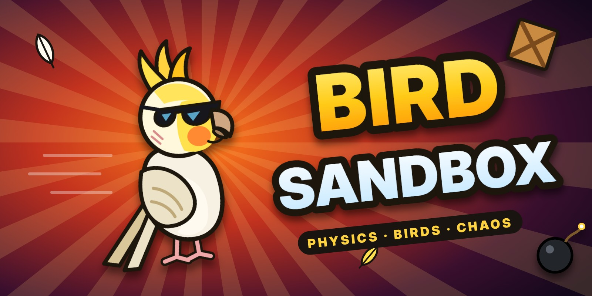

# 🐦 Bird Sandbox

A ragdoll physics sandbox (like Melon Sandbox / People Playground) starring my pet birds — Cookie, Lightning, Snowflake, Mini Snowflake, Salman, Lemon, Jafar, Abbas, Mango, Silver, Pikachu, Aziz, Coco, Orange — and my cat Vex.

## Play
Open `index.html` in a browser, or turn on **GitHub Pages** (Settings → Pages → Deploy from branch → `main` / root) and play at
`https://abbas-is-tuff.github.io/Bird-Sandbox/`

On iPad: open it in Safari → Share → **Add to Home Screen** to play full screen like an app.

## Play offline
Open the GitHub Pages link once with internet, then in Safari tap Share → **Add to Home Screen**. The game saves itself on your iPad and works with no internet. It updates itself whenever you open it while online.

## What's inside
- 10 maps: Meadow, Beach, Snowy Mountains, Desert, Jungle, Farm, Savanna, City Park, the Moon and an Empty world
- 60+ birds and 35+ animals with ragdoll physics — limbs can snap off, they catch fire, swim, fly and fight back
- Build mode (wood, stone, brick, glass, steel, roofs), plants, weather, day & night
- Items: cannon, slingshot, rockets, water bucket, hot air balloon, trampolines, portals and lots more
- Undo, search, save & load
